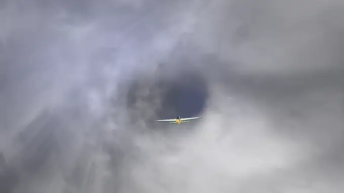

# 白色战争迷雾

在团结 Hub 添加本目录，使用团结 1.9.3（2022.3.62t11）打开。工程使用团结内置 URP 14.2.0-t1 和线性色彩空间。

## 双平台演示

### 开雾与镜头缩放

| PC 原画质 | 微信小游戏平衡档 |
| --- | --- |
|  |  |
| [完整 MP4](WhiteFog-PC.mp4) · [PC 演示场景](Assets/Scenes/WhiteFog.unity) | [完整 MP4](WhiteFog-WeChat.mp4) · [微信演示场景](Assets/Scenes/WhiteFog_WeChat.unity) |

两段开雾演示均为团结编辑器实录，各 12 秒，镜头和操作顺序相同。

### 天气颜色变化

固定镜头和开雾范围，用 8 秒走完原本 800 秒的昼夜雾色周期。留意雾边从夜间冷色转为晨光暖金、日间灰白和晚霞暖色，再回到夜色。两段均为团结编辑器实录，使用相同的预设和时间进度。

| PC 原画质 | 微信小游戏平衡档 |
| --- | --- |
|  |  |
| [完整 MP4](WhiteFog-Weather-PC.mp4) | [完整 MP4](WhiteFog-Weather-WeChat.mp4) |

### Mesh 云海穿梭与局部雷光

[团结编辑器实录 · 24 秒](Assets/CloudFlight/Media~/CloudFlight-Unity.mp4) · [小游戏渲染器的浏览器 WebGL 预览 · 24 秒](Assets/CloudFlight/Media~/CloudFlight-WebGL.mp4)

打开独立场景 [CloudFlight.unity](Assets/CloudFlight/CloudFlight.unity)，进入 Play 即可沿云海飞行。微信开发者工具选择「小游戏」并导入 [WeChatMiniGame](Assets/CloudFlight/WeChatMiniGame)。轻点屏幕或按空格可切换跟拍距离。录像约 4.2 秒时左侧灰色云壁大范围透亮，约 7.5 秒时左上方云沿再次泛起冷白色雷光。

#### 云洞和雷光是怎么做出来的？

1. **先做出云海，再挖出航道。** 想象把空间分成许多小格，每格记一个数，表示这里的云有多浓。三维噪波让相邻格子的浓淡自然过渡，形成起伏的云脊。沿飞机的路线把中间的密度降下来，就挖出了云洞。洞顶、两侧和下沿连成一圈，飞机可以从中间穿过。
2. **让浓云遮挡，让薄雾透光。** 把浓云的轮廓做成三角网格，在边缘铺几层弯曲的半透明网格。镜头贴着云边飞时，眼前的薄雾很快掠过机翼，远处的云壁在画面里移动得更慢。这种前后错动让人看得出云洞有多深。
3. **让一片云从里面亮起来。** 大约每 3.2 秒，程序从航线附近有云的位置随机挑一点。离这点越近，云就越亮。可以把自制的 MatCap 贴图想成一张受光球面的照片。云面朝上、朝侧面时，着色器会从照片上的不同位置取亮度。这样，即使一大片灰云同时透亮，也能看出云面的凹凸。雷光约用 0.3 秒亮起，再用约 1 秒暗回去。场景里的 `Flash Strength` 可以调节强度，设为 0 即可关闭。

#### 微信小游戏怎样控制开销？

云的形状和基础光照提前算好，PC 和小游戏共用这套网格和贴图。飞行时直接画网格、读取贴图，再叠加当前的局部雷光，省去了实时光线步进（Ray Marching）沿每条视线反复计算云密度的开销。192 米的航线按 24 米分块循环复用，每帧只绘制镜头附近、沿航向可见的分块。

小游戏的目标为 30 FPS，横屏渲染上限为 960×540。上方的小游戏录像取自桌面浏览器，手机帧率尚待实测。

### 金色云洞穿行与局部紫色雷光

[PC 实录](Assets/GoldenCloudVortex/Media~/GoldenCloudVortex-PC.mp4) · [小游戏渲染器桌面 WebGL 2 实录](Assets/GoldenCloudVortex/Media~/GoldenCloudVortex-WebGL.mp4) · [场景、原理和性能参数](Assets/GoldenCloudVortex/README.md)

### 运行演示

切换构建目标时，工程自动选择对应演示场景。微信小游戏（MiniGame）和 WebGL 使用移动场景及 WebGL 2，Standalone 使用 PC 场景。可以在桌面编辑器中直接打开任一场景预览。手机上轻点完全开雾，长按松开切换半可见，双指捏合缩放。

PC 场景使用原计算着色器、高密度网格和两张 2048 噪声纹理。移动场景采用 128×128 的 CPU R8 遮罩，变化时最多每秒上传 15 次。每个开雾点按原公式独立合并三段可见度，遮罩与世界坐标原点同步更新。移动材质使用两张保留 mip 的 1024 R8 噪声纹理，顶点采一次云纹，片元采两次，逐帧滚动，保留场景深度软交界。

移动雾面覆盖 192×192 个世界单位，中心网格间距为 1，外围为 2，两者边界共用顶点。按 16×16 世界单位分块，使用包含上下位移的包围盒与当前相机视锥相交测试。只有可见块集合改变时才更新索引，同一相机的可见雾面合为一次绘制。

## 观看效果

进入 Play 后，基地位置按原版 1.5 秒曲线揭开。鼠标滚轮拉远可以同时看到雾内、雾边和雾外。灰色平面用于观察雾的透明度和深度交界。

| 操作 | 效果 |
| --- | --- |
| 左键点击地面 | 在点击位置完全开雾 |
| Shift + 左键 | 在点击位置切换为半可见 |
| 1 / 2 / 3 | 将最近一次点击的位置切为隐藏、半可见、完全可见 |
| 右键 | 让所有打开的区域重新合拢 |
| 滚轮 | 缩放观察距离 |
| 空格 | 暂停或恢复昼夜变化，云纹保持滚动 |
| 按住 [ 或 ] | 向前或向后调整昼夜相位 |

## 对应的原版资源

| 工程内容 | 原始来源 |
| --- | --- |
| FogOfWar.shader / FogOfWar.mat | sharedassets3.assets 中的 DOD/VFX/FogOfWar（408）和 FogOfWar（27）。前向顶点与片元程序按 D3D11 编译指令转写为 HLSL |
| FogMask.compute | sharedassets3.assets 中的 FogOfWar 计算程序（436）。三个可见度区间、重叠取最大值和遮罩边缘衰减均取自原程序 |
| NoiseClouds1 / NoiseClouds2 | sharedassets0.assets 中的 599 和 953，原始 2048×2048 R8 像素及 12 级 mip。A、B 两层共用第二张 |
| 两种雾面网格 | sharedassets3.assets 中的 272 和 328，沿用原始顶点、法线和三角索引 |
| OriginalFogPreset.asset | FogOfWarTransitionPreset（2893）和 TimeOfDayPreset_Default（2895）的可见度、半径、颜色和定向光强度关键帧 |
| FogOfWar.cs | level3 的实际配置。网格高度 5.8，遮罩在 200 个世界单位内使用 128×128 的 R16_SFloat，昼夜周期 800 秒 |

`FogPreview.cs` 提供独立场景的鼠标、键盘和镜头操作。复用雾效时可以直接调用 `FogOfWar.SetVisibility(xz, state, radius)`。state 的 0、1、2 依次表示隐藏、半可见和完全可见。当前场景使用默认昼夜预设，最终画面由独立预览相机渲染。原关卡地形和整屏后期会影响与游戏截图的对比。
