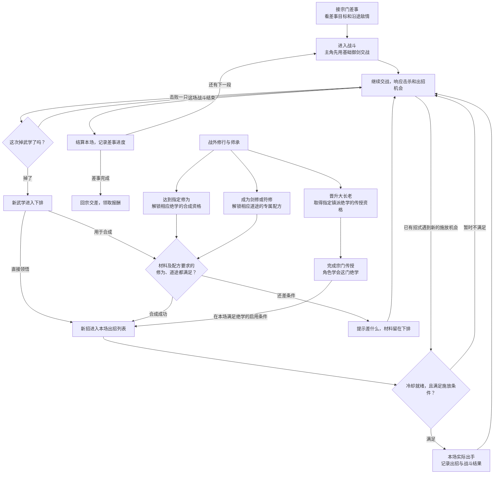

# 青云宗 · 接差与战中拿招流程

接下差事后直接进战。主角先用基础御剑交战，玩家从战斗中取得武学，当场领悟或合成。新招进入本场出招列表，等满足施放条件后即可在本场出手。

## 流程图

## 用雾鸢验证当场出手

护送途中，主角打倒第一只雾鸢。假设这次掉了配方缺少的武学，玩家在下排用材料合出镇行符。第二只雾鸢开始俯冲时，如果镇行符已经就绪，就能尝试拦截这一次俯冲。战报依次记录合成、出手、实际拦截结果。

## 规则与待定项

- **差事页**显示任务目标和敌情。普通武学从本场战斗中取得。
- **配方门槛**按招式配置。某门符法可以同时要求符修身份和指定修为，材料齐备后才可合成。
- **宗门传授**用于少数特殊绝学。大长老是指定镇派绝学的习得门槛，完成传授时才记为已学。战中满足该绝学的启用条件时，进入本场出招列表。
- **掉落概率和跨场保留**待定。图按击杀时做一次概率判定来推演。连打两段差事时，下排材料和已成的普通武学能留多久，后续单独确定。
