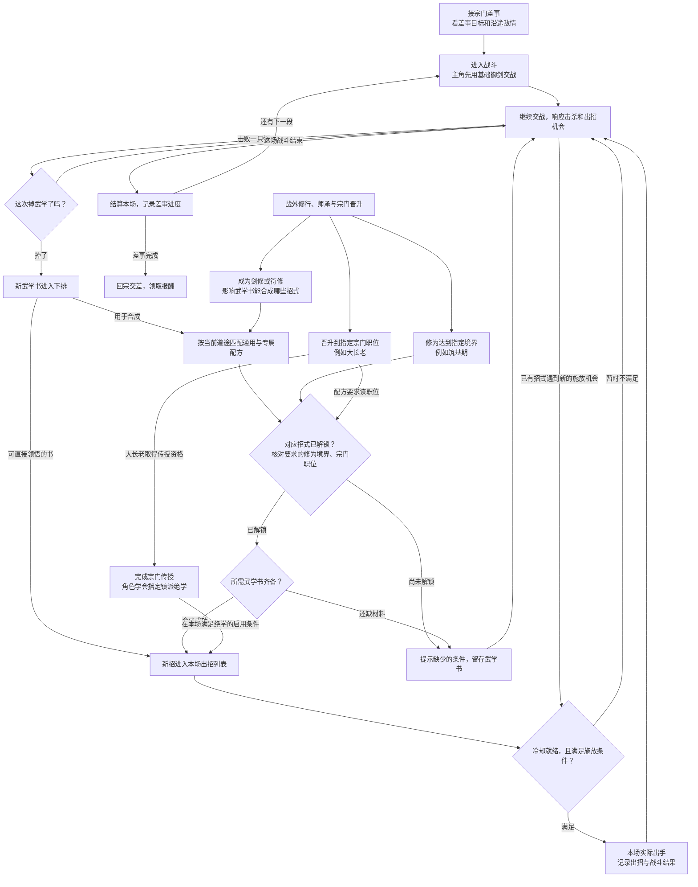

# 青云宗 · 接差与战中拿招流程

接下差事后直接进战。主角先用基础御剑交战，玩家从战斗中取得武学，当场领悟或合成。新招进入本场出招列表，等满足施放条件后即可在本场出手。

## 流程图

## 用雾鸢验证当场出手

护送途中，主角打倒第一只雾鸢。假设这次掉了配方缺少的武学，玩家在下排用材料合出镇行符。第二只雾鸢开始俯冲时，如果镇行符已经就绪，就能尝试拦截这一次俯冲。战报依次记录合成、出手、实际拦截结果。

## 规则与待定项

- **差事页**显示任务目标和敌情。普通武学从本场战斗中取得。
- **道途影响合成结果。** 后续掉到的武学书，可以参与哪些配方，取决于角色走的是剑修、符修等哪条道途，以及书与配方的具体配置。通用配方也可保留。
- **解锁决定哪些招能合出来。** 个别武学书关联的招式要求指定修为境界或宗门职位，例如筑基期取得某门剑诀的合成资格。每张配方可单独设置条件。只有解锁的招式才可能成为合成结果，材料齐备后才能尝试合成。
- **宗门传授**用于少数特殊绝学。大长老是指定镇派绝学的习得门槛，完成传授时才记为已学。战中满足该绝学的启用条件时，进入本场出招列表。
- **待定项**包括掉落概率、掉落书池是否随道途变化、已解锁结果如何选取，以及下排材料和已成招式的跨场保留。图按击杀时做一次概率判定来推演。
